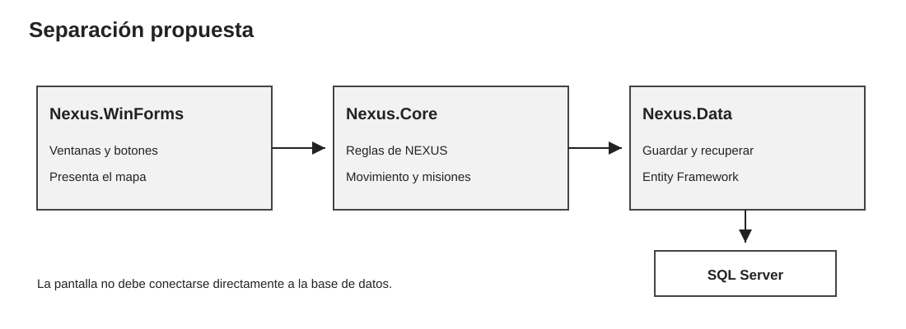

# Arquitectura propuesta para NEXUS

## Idea general

En H3 las reglas y los mensajes de consola están mezclados en Program.cs. Para pasar a una experiencia gráfica propongo separar la aplicación en tres proyectos. No dividiría cada clase en un proyecto distinto: al inicio sería más trabajo y costaría entender dónde va cada cosa.

La flecha de inicio representa la configuración que une la aplicación y los servicios de datos. Los formularios no ejecutan consultas SQL directamente.

## Proyectos y responsabilidades

### Nexus.WinForms

Contiene MainMenuForm, ExplorationForm, MissionPanel y ExplorerInventoryForm. La cuadrícula puede empezar como un TableLayoutPanel de 4 × 5 con botones. Cada botón representa una casilla, su símbolo y si está seleccionada. Los clics o teclas llaman acciones del servicio y después actualizan los controles.

Los formularios presentan datos y reciben acciones. No guardan energía por su cuenta ni abren conexiones a SQL. Para evitar congelar la ventana mientras se lee o guarda, las operaciones de base deberían usar métodos asíncronos y await.

### Nexus.Core

Contiene el dominio y las acciones de la aplicación. Aquí movería Personaje, Cadete, Robot, Enemigo, Objeto y sus tipos concretos, Inventario, Mapa y Mision. Simulador se dividiría en acciones pequeñas, por ejemplo CrearPartida, MoverCadete, ExplorarCasilla, UsarObjeto, Descansar y Extraer.

Esta parte no usaría Console, MessageBox ni controles de Windows Forms. Las reglas devuelven el resultado de una acción; la pantalla decide cómo presentarlo. Las interfaces IPartidaRepository e IExploradorRepository describen qué se puede guardar o leer, sin definir cómo SQL Server lo hace.

### Nexus.Data

Contiene NexusDbContext, las entidades de persistencia y las implementaciones de los repositorios. Usaría el proveedor Microsoft.EntityFrameworkCore.SqlServer. EF Core traduce operaciones de datos y permite actualizar el esquema con migraciones.

## Camino de una acción

1. El jugador pulsa una casilla adyacente o una tecla en ExplorationForm.
2. El formulario llama a PartidaService.MoverAsync con la partida y la dirección.
3. Nexus.Core valida los límites, descuenta energía y resuelve el evento con las reglas que hoy están en Mapa, Simulador y Fabrica.
4. La pantalla recibe el resultado y refresca mapa, estado y objetivos.
5. Si se solicita guardar o se llega a un punto de control, el servicio pasa el estado al repositorio.
6. Nexus.Data guarda partida, objetivos, casillas exploradas y objetos en SQL Server.

## Cómo evolucionaría desde H3

| Código actual | Cambio propuesto |
|---|---|
| Consola | Se retira de las reglas; los formularios validan y presentan la entrada. |
| Personaje, Cadete, Robot, Enemigo | Se conservan las reglas de herencia; se quitan escrituras a consola de Mostrar y del combate. |
| Objeto y tipos concretos | Se conservan sus efectos; la interfaz enseña descripción y resultado. |
| Inventario | Mantiene seis espacios y operaciones; expone los objetos para mostrarlos y restaurarlos. |
| Mapa | Mantiene celdas, coordenadas y visitadas; deja de dibujar por consola. |
| Mision | Mantiene objetivos H3; los muestra el panel de misiones. |
| Simulador | Se divide entre acciones de aplicación y formularios. No se reescribe la mecánica desde cero. |
| Fabrica y Encuentro | Podrían recibir una fuente de azar para que los resultados sean más fáciles de repetir. |
| No hay guardado | Se agrega un repositorio y persistencia en SQL Server. |

## Estructura sugerida

- README.md y .gitignore en la raíz.
- NEXUS.sln como solución de la nueva etapa.
- src/Nexus.Core/ para modelo y reglas.
- src/Nexus.Data/ para persistencia y SQL Server.
- src/Nexus.WinForms/ para las ventanas y controles.
- docs/ para esta documentación.

Esta estructura es una propuesta para otra etapa. No he agregado esos proyectos ni he cambiado el programa de consola como parte de esta documentación.

## Orden de implementación

1. Mover las clases del modelo a Nexus.Core y reemplazar salidas a consola por resultados de acciones.
2. Comprobar que la misión y reglas existentes sigan funcionando antes de crear pantallas.
3. Crear la solución Windows Forms y mostrar el mapa fijo.
4. Conectar las pantallas con servicios, manteniendo las reglas en Core.
5. Crear el esquema SQL Server, repositorios y acciones de guardar/cargar.
6. Agregar misiones y mejoras visuales después de comprobar que se puede terminar y retomar una partida.

La guía de arquitectura de .NET recomienda separar responsabilidades de presentación, lógica y acceso a datos. La uso como orientación general, no como obligación de crear muchos proyectos desde el primer día: [arquitectura en capas para .NET](https://learn.microsoft.com/en-us/dotnet/architecture/modern-web-apps-azure/common-web-application-architectures).