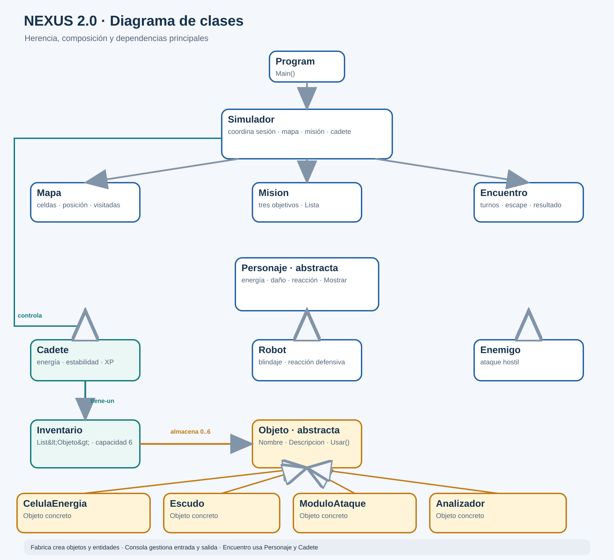
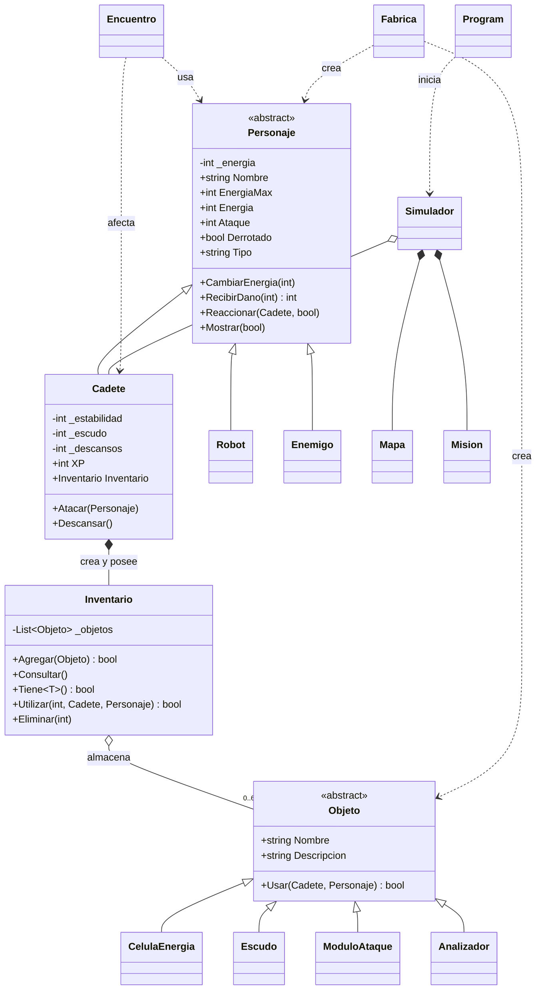
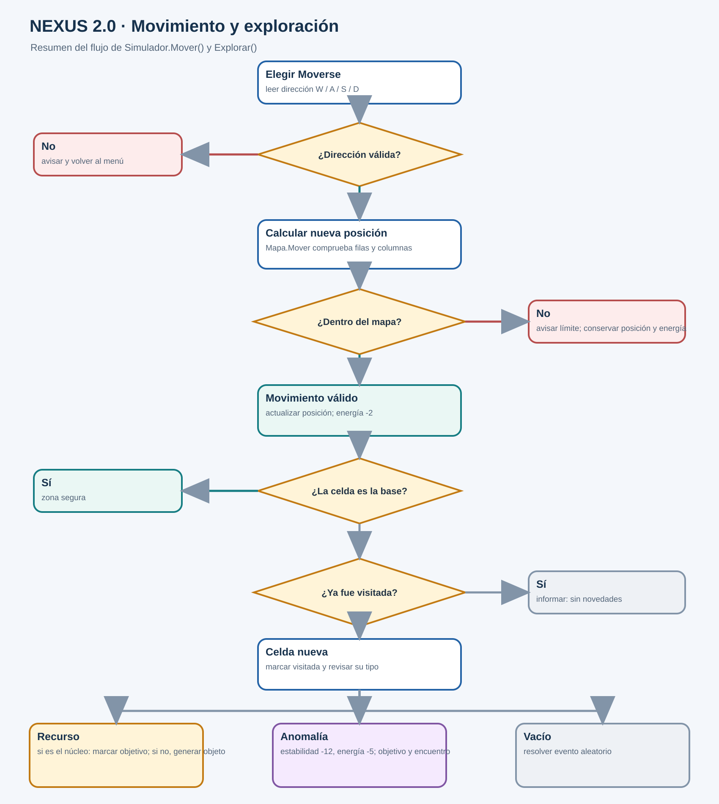
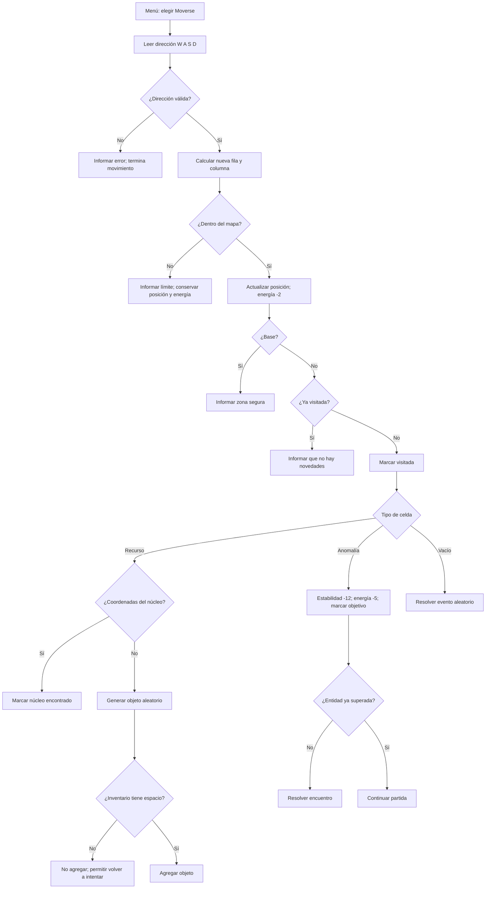

# Diagramas de NEXUS

Los diagramas describen la versión de `Program.cs` revisada el 12 de octubre de 2026. Las imágenes SVG y los bloques Mermaid permiten consultarlos y editarlos; también se conservan imágenes PNG para generar la edición PDF.

## Diagrama de clases

La línea de triángulo hueco indica herencia. El rombo lleno marca la composición de `Cadete` con su inventario y del simulador con mapa/misión. La lista del inventario mantiene una agregación de hasta seis referencias de tipo `Objeto`. Las flechas punteadas muestran dependencias de uso, no herencia.

## Flujo de movimiento y exploración

El flujo sigue `Simulador.Mover`, `Mapa.Mover` y `Simulador.Explorar`. Los eventos aleatorios y el combate pueden tener resultados diferentes entre ejecuciones.

