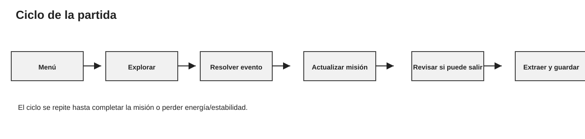
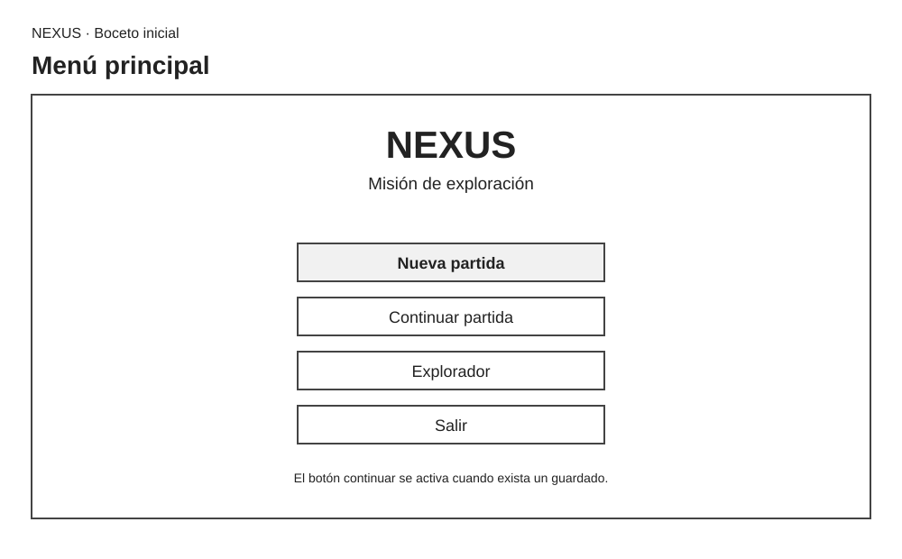
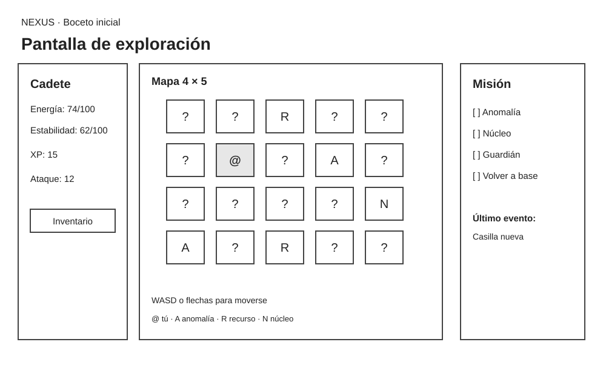
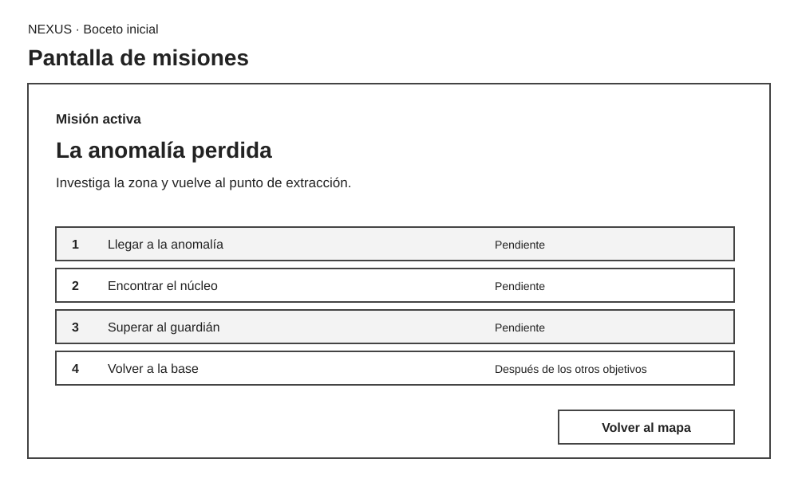
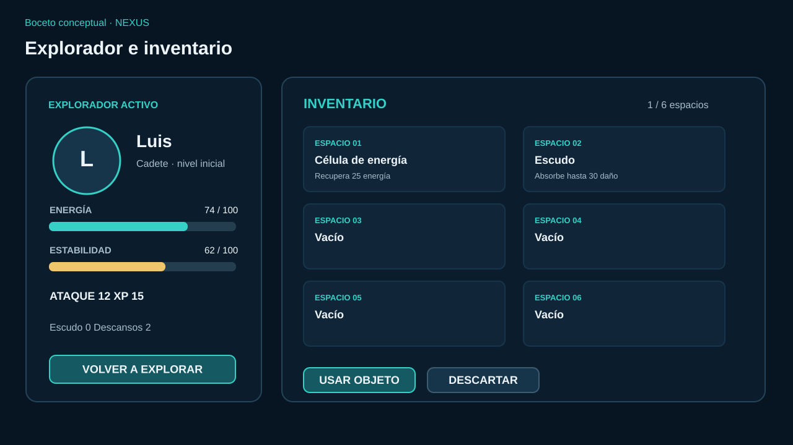

# NEXUS: diseño del juego

## Visión

NEXUS será una aventura de exploración de ciencia ficción. La persona que juega controla a un cadete, revisa el mapa, decide por dónde avanzar y trata de volver a la base sin quedarse sin energía ni estabilidad. La historia sigue la del programa H3: investigar una anomalía, recuperar el núcleo energético y superar al guardián.

Lo que puede motivar a seguir es descubrir zonas que todavía no se conocen, escoger cuándo gastar los objetos y ver cómo avanza la misión. En esta primera propuesta no imagino un juego de disparos ni en 3D. Me parece más viable convertir el mapa de texto actual en un tablero gráfico y hacer más clara la información que ahora aparece en la consola.

H3 crea un Cadete por partida. Por eso, en la primera versión gráfica la pantalla “Exploradores” muestra y permite revisar al Cadete activo. Tener un grupo de cadetes sería una ampliación posterior; no es una función actual.

## Ciclo principal de juego

El jugador se mueve casilla por casilla. Después de cada movimiento el juego revisa qué hay, presenta el resultado y actualiza los indicadores. La partida termina si el cadete cae o si completa los objetivos y regresa a la base para extraerse.

## Mecánicas y reglas

| Elemento | En H3 | En la propuesta gráfica |
|---|---|---|
| Explorador | Un Cadete con energía, estabilidad, ataque, XP e inventario. | El mismo Cadete se muestra en una ficha. La selección de varios cadetes queda para después. |
| Mapa | Cuadrícula fija de 4 × 5; Mapa conserva las celdas visitadas. | Cada casilla será un botón o control. Se oculta la información no descubierta y se marca la posición actual. |
| Movimiento | W, A, S, D mueve una casilla y consume 2 de energía. No permite salir de los límites. | Se podrá usar ratón o teclado. Se muestra un mensaje al moverse o al intentar cruzar el borde. |
| Anomalía | Resta 12 de estabilidad y 5 de energía. Puede iniciar el encuentro con el Guardián de 50 de energía y ataque 9. | Se destaca y abre una tarjeta de encuentro con el estado y las acciones disponibles. |
| Recursos | Hay objetos aleatorios. El núcleo está en la casilla (2,4), con índices desde cero. | El mapa marca hallazgos conocidos y los objetos recogidos aparecen en el inventario. |
| Inventario | Capacidad de 6 objetos. Un objeto se consume solo si su uso tiene éxito. | Se muestran seis espacios con nombre y descripción, con botones “Usar” y “Descartar”. |
| Misión | Llegar a una anomalía, encontrar el núcleo, superar la entidad y extraerse desde la base. | Un panel muestra los objetivos y su avance; extraerse es el paso final. |
| Descanso | En la base quedan dos descansos; cada uno suma 20 de energía y 15 de estabilidad. | El botón “Descansar” se habilita solo en la base y muestra cuánto recupera. |
| Eventos | Las zonas vacías pueden no dar nada, entregar un objeto, iniciar encuentro, dar información o causar daño. | Una tarjeta explica qué pasó y qué valores cambiaron. |
| Progresión | La extracción intenta agregar un módulo; si el inventario está lleno no se completa. Si logra agregarlo, da 100 XP. Los módulos pueden mejorar ataque. | Se guarda el resultado y se podría desbloquear otra misión. Al inicio no agrego niveles automáticos porque H3 no los tiene. |

La cuadrícula actual tiene base en (1,1), anomalías en (1,3) y (3,0), y recursos en (0,2), (2,4) y (3,2). Las coordenadas comienzan en cero, como los arreglos de C#.

## Diseño de pantallas

Los dibujos siguientes son bocetos, no pantallas implementadas. Propongo una apariencia de ciencia ficción sobria: fondo azul oscuro, paneles con contraste y turquesa para las acciones principales. El rojo se reserva para peligro y el verde para objetivos completos.

### Menú principal

Permite iniciar una partida, continuar un guardado, revisar al cadete o salir. “Continuar” aparece deshabilitado cuando no existe un guardado.

### Exploración y mapa

El mapa queda en el centro; estado y objetivos permanecen visibles. Al seleccionar una casilla, la interfaz explica el costo y resultado. Una zona peligrosa abre un panel de encuentro.

### Misiones

Resume la misión actual, sus pasos y las recompensas conocidas. “Volver al mapa” conserva la partida; los objetivos solo cambian cuando el juego resuelve una acción.

### Explorador e inventario

La ficha muestra los datos del Cadete y sus seis espacios de inventario. El primer alcance tiene un solo cadete activo, igual que H3. Más adelante se podría permitir cambiar de explorador.

## Navegación

- Menú → Nueva partida → ficha del Cadete → Exploración.
- Menú → Continuar → último guardado → Exploración.
- Exploración → Misión o Explorador/Inventario → Volver a Exploración.
- Desde la base, con objetivos completos → Extraer → resumen → Guardar y volver al menú.
- Si energía o estabilidad llegan a cero → resumen de derrota → cargar un guardado anterior o iniciar otra partida.

En la primera versión usaría una ventana principal con paneles que se reemplazan. Así no se abren muchas ventanas y siempre queda claro cómo volver al mapa.

## Criterios de experiencia de usuario

- **Legibilidad:** texto de buen tamaño y contraste; no depender solo del color para indicar peligro u objetivo.
- **Jerarquía:** energía, estabilidad, posición y siguiente objetivo se ven primero.
- **Consistencia:** el mismo botón, icono y color significa lo mismo en todas las pantallas.
- **Navegación sencilla:** “Volver” queda siempre en el mismo lugar.
- **Retroalimentación:** movimiento, objeto usado, daño y objetivo completado muestran qué pasó y cuánto cambió el estado.
- **Prevención de errores:** acciones que gastan o descartan algo explican su efecto; no se permite salir del mapa.
- **Teclado y ratón:** el tablero se maneja con flechas o WASD y los controles también se pueden seleccionar con el ratón.

## Alcance y restricciones

### Prioridad de la primera versión

1. Mantener una misión H3 y el mapa fijo de 4 × 5.
2. Mostrar mapa, posición, energía, estabilidad, objetivos e inventario en Windows Forms.
3. Conservar movimiento, eventos, objetos, guardián y extracción.
4. Crear, guardar, cerrar y continuar una partida usando SQL Server.
5. Mostrar mensajes claros de éxito, error o falta de conexión.

### Opcional para después

- Más mapas y misiones.
- Selección de varios exploradores o equipo.
- Animaciones, sonido y editor de mapas.
- Récords o sincronización remota.
- Autoguardado después de cada evento.

### Restricciones

Windows Forms es una tecnología de escritorio para Windows, así que la propuesta gráfica se ejecutará en Windows. El proyecto actual es una aplicación de consola en net10.0; todavía no incluye formularios, SQL Server ni guardado. Primero se deben separar las reglas de la consola. SQL Server debe instalarse y configurarse; LocalDB puede servir para desarrollo local. Esta propuesta no afirma que la versión gráfica ya exista.