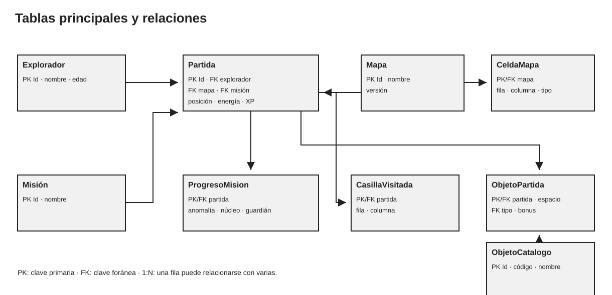

# Modelo de datos propuesto

## Para qué se necesita

La partida actual solo está en memoria. Al cerrar NEXUS se pierden posición, energía, objetos, objetivos, casillas visitadas y XP. La base debe guardar suficiente estado para reconstruirla al continuar.

Propongo iniciar con una misión y el mapa H3. Mapa y Mision se guardan como catálogos separados para agregar más opciones sin duplicar toda la lógica en la pantalla.

## Diagrama de entidades

## Tablas principales

| Tabla | Datos propuestos | Relación y motivo |
|---|---|---|
| Explorador | ExploradorId (PK), Nombre, Edad, FechaCreacion | Perfil del Cadete. Un perfil puede tener más de un guardado. |
| Mapa | MapaId (PK), Codigo, Nombre, Version | Identifica el mapa y su versión. |
| CeldaMapa | MapaId (PK/FK), Fila (PK), Columna (PK), TipoCelda | Define las celdas fijas, equivalente a _celdas en Mapa. |
| Mision | MisionId (PK), Codigo, Nombre, Descripcion | Catálogo de misiones; H3 comienza con “La anomalía perdida”. |
| Partida | PartidaId (PK), ExploradorId (FK), MapaId (FK), MisionId (FK), Estado, fechas, Fila, Columna, Energia, Estabilidad, Ataque, XP, Escudo, Descansos, AnalisisActivo | Guarda estado que ahora mantienen Cadete, Mapa y Simulador. |
| ProgresoMision | PartidaId (PK/FK), LlegoAnomalia, NucleoEncontrado, EntidadSuperada | Corresponde a los tres booleanos de Mision. La extracción se valida con objetivos completos y posición en la base. |
| CasillaVisitada | PartidaId (PK/FK), Fila (PK), Columna (PK), FechaVisita | Recuerda las casillas ya exploradas. |
| ObjetoCatalogo | ObjetoCatalogoId (PK), Codigo, Nombre, Descripcion, Tipo | Describe célula, escudo, módulo y analizador. |
| ObjetoPartida | PartidaId (PK/FK), Espacio (PK), ObjetoCatalogoId (FK), NombreMostrado, BonusAtaque | Guarda cada objeto en el inventario y conserva sus datos particulares. |

PK significa clave primaria y FK clave foránea. Las claves primarias identifican una fila; las foráneas enlazan filas de otras tablas y ayudan a prevenir referencias inexistentes. SQL Server puede hacer cumplir esas relaciones mediante restricciones: [claves primarias y foráneas](https://learn.microsoft.com/en-us/sql/relational-databases/tables/primary-and-foreign-key-constraints?view=sql-server-ver17).

## Relaciones

- Un Explorador puede tener varias Partidas guardadas; cada Partida corresponde a un Explorador.
- Cada Partida usa un Mapa y una Mision.
- Un Mapa contiene muchas celdas.
- Una Partida contiene una fila de ProgresoMision y varias casillas visitadas.
- Una Partida puede llevar hasta seis ObjetoPartida; cada objeto parte de un tipo en ObjetoCatalogo.
- La partida usa la definición estática de celdas del mapa y guarda aparte cuáles visitó el jugador.

## Reglas de integridad

- Energía y estabilidad se limitan a 0–100, como en Cadete; ataque y XP no deben ser negativos.
- Fila y Columna deben quedar dentro del mapa asociado.
- Espacio del inventario va de 1 a 6 y no se repite dentro de una partida.
- Cada Partida debe tener un explorador, mapa y misión existentes.
- Solo hay una fila de ProgresoMision por partida. Los objetivos los cambia el juego, no la interfaz.
- Codigo de mapa, misión y objeto es único.
- Al recuperar una partida se valida la versión del mapa guardado.

Para varias misiones, reemplazaría los tres indicadores fijos por tablas ObjetivoMision y ProgresoObjetivo. Para la única misión H3, los tres indicadores son más fáciles de entender y corresponden a la clase actual.

## Cómo guardar y recuperar

**Guardar:** el jugador elige Guardar. La capa de aplicación revisa el estado y el repositorio prepara partida, progreso, casillas y objetos. EF Core aplica cambios con SaveChangesAsync. Según la documentación, SaveChanges usa transacción en proveedores compatibles; si falla una operación, los cambios de esa llamada se revierten: [guardar cambios en EF Core](https://learn.microsoft.com/en-us/ef/core/saving/basic).

**Recuperar:** se elige una partida del menú; el repositorio busca su ID y carga explorador, mapa, progreso, celdas y objetos. Después se reconstruyen Cadete, Mapa, Inventario y Mision; la pantalla presenta esos datos. Si cambió la versión del mapa, se avisa antes de continuar.

En la primera versión guardaría al pulsar Guardar, al completar una misión y al salir normalmente. No guardaría cada movimiento porque son muchas escrituras innecesarias. El autoguardado al final de cada evento puede añadirse después.

Para desarrollar en una computadora se puede usar SQL Server Express LocalDB, una instancia ligera de SQL Server Express pensada para desarrollo. No sirve automáticamente como base central compartida entre varias computadoras; eso requiere SQL Server accesible por red y credenciales configuradas fuera del repositorio: [SQL Server Express LocalDB](https://learn.microsoft.com/es-es/sql/database-engine/configure-windows/sql-server-express-localdb?view=sql-server-ver17).